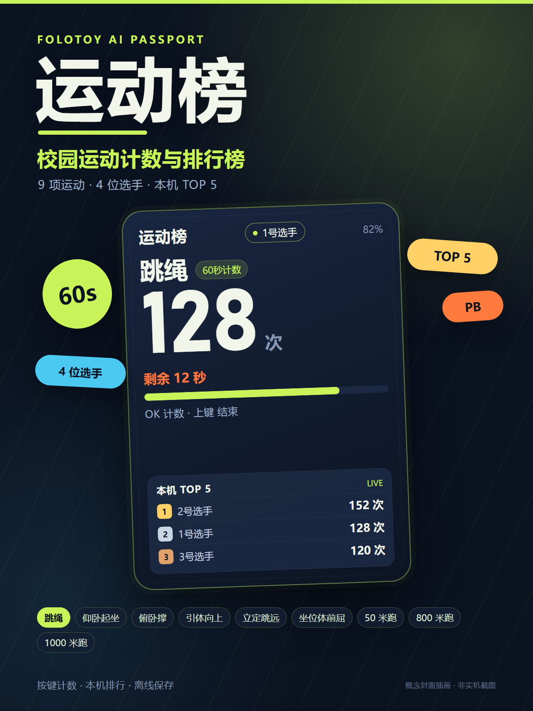

<p align="right">
  <a href="README.zh_CN.md">简体中文</a> · <strong>English</strong>
</p>

<p align="center">
  
</p>

<h1 align="center">Sports Board</h1>

<p align="center">
  <strong>A pocket school-sports counter and local leaderboard for FoloToy AI Passport.</strong>
</p>

Sports Board turns AI Passport into a handheld counter for nine common school
sports. It is an offline, three-button application for PE classes, recess, and
family fitness. Tap OK for each rep, time runs with a stopwatch, enter jump and
reach distances with the arrow keys, then compare results on a local top-five
board for four players.

This is a derivative application, not the repository's hardware-test menu. It
reuses the BSP drivers and replaces the demo UI with a purpose-built 240×320
interface; it does not reuse the demo screens or visual shell.

## Events

| Event | Mode | How it is recorded |
| --- | --- | --- |
| Jump rope | 60-second count | First OK starts the countdown; OK adds one rep; UP settles early |
| Sit-ups | 60-second count | Same as jump rope |
| Push-ups | Free count | OK adds one rep; UP finishes |
| Pull-ups | Free count | Same as push-ups |
| Standing long jump | Distance | UP/DOWN adjusts 0–300 cm; OK saves |
| Sit-and-reach | Distance | UP/DOWN adjusts -20–40 cm; OK saves |
| 50 m run | Stopwatch | OK starts/stops; UP also finishes |
| 800 m run | Stopwatch | Same as 50 m |
| 1000 m run | Stopwatch | Same as 50 m |

## Controls

| Screen | UP / DOWN | OK | Long press |
| --- | --- | --- | --- |
| Home | Select an event | Enter | Long OK: leaderboard; long UP: next player |
| Ready | Switch players 1–4 | Start | Return home |
| Count | Finish and save | Add a rep | — |
| Stopwatch | Finish / return | Start / stop | — |
| Distance | Adjust the result | Save | Cancel |
| Result | Leaderboard | Retry | Return home |
| Leaderboard | Switch events | Challenge | Return home |

Count events are recorded manually with OK; the device has no motion sensor.
Jump rope and sit-ups use a 60-second countdown. Rankings use raw results: count
descending with shorter duration as the tie-break, time ascending, and distance
descending. The board keeps a top five per event and a personal best per player.
Results and the selected player are stored in NVS and survive power loss.

## Build and test

ESP-IDF 5.5.3 is required. See
[`docs/development/engineering/environment-setup.md`](docs/development/engineering/environment-setup.md)
and [`docs/development/engineering/build-and-test.md`](docs/development/engineering/build-and-test.md).

```bash
source "$IDF_PATH/export.sh"
./tools/validate.sh
```

The complete gate runs repository checks, host tests, the ESP-IDF build, the
merged-image layout check, and the firmware archive. The flashable image is
`build/FoloToy-AI-Passport-full.bin`.

## Flash

```bash
python -m esptool --chip esp32c3 -p <PORT> -b 460800 \
  --before default_reset --after hard_reset \
  write_flash --flash_mode dio --flash_size 8MB --flash_freq 80m \
  0x0 build/FoloToy-AI-Passport-full.bin
```

A merged 0x0 flash covers the NVS/PHY area and may clear the local leaderboard,
personal bests, selected player, and other NVS data. Use a compatible segmented
flash if those settings must be preserved. Never flash the application-only
image at 0x0.

## Community release

- Community app name: `sports-board`
- Release version: `1.0.0`
- Firmware build identity: `488beda-dirty`
- Merged image: 910,560 bytes, SHA-256
  `092cb6397eefe3ebc428b420ff656852a9e3265a2a4d4daa68fa501b78c5bdb6`

The release image is prepared for the AI Passport community listing; it is not
committed to this repository. The cover above is a concept illustration, not
a device screenshot. Device acceptance is still pending: run the checklist in the
community user guide on a real device before treating the release as hardware
verified.

## Repository layout

- `components/bsp/` — board support package (reused, not forked).
- `main/sports_app.c` — redesigned UI and application state.
- `main/sports_model.c` — event table, ranking, personal bests, NVS codec.
- `main/sports_store.c` — NVS persistence.
- `assets/fonts/` — fixed Noto Sans SC subsets for the Chinese UI.
- `tests/` — host tests and font-coverage checks.

The full project documentation is in [`docs/README.md`](docs/README.md). The
BSP and layout behavior remain governed by the upstream AI Passport project:
[`FoloToy/ai-passport`](https://github.com/FoloToy/ai-passport).

## License

The project source is released under the MIT License; see [`LICENSE`](LICENSE).
The Chinese font data derives from Noto Sans SC Regular under the SIL Open Font
License 1.1; see [`assets/fonts/NotoSansSC-OFL.txt`](assets/fonts/NotoSansSC-OFL.txt).
