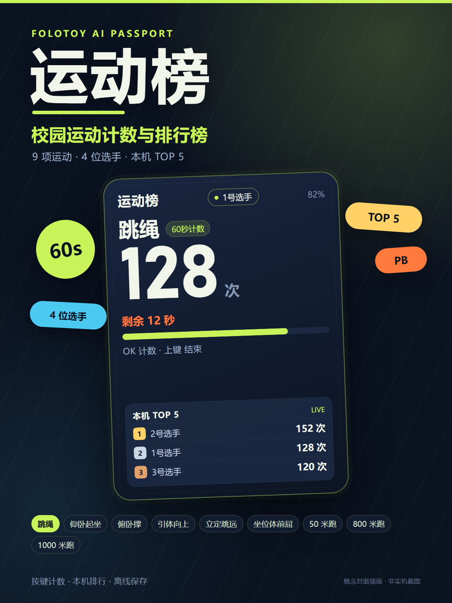

<p align="right">
  <strong>简体中文</strong> · <a href="README.md">English</a>
</p>

<p align="center">
  
</p>

<h1 align="center">运动榜</h1>

<p align="center">
  <strong>FoloToy AI Passport 的校园运动计数器与本机排行榜。</strong>
</p>

运动榜把 AI Passport 变成一台随身运动计数器，覆盖 9 个中小学常见体育项目。
它是一款离线、三按键应用，适合体育课、课间训练和家庭运动打卡：每完成一次动作
按 OK 计数，跑步用秒表计时，立定跳远和坐位体前屈用上/下键录入成绩，最后在
1–4 号选手的本机前 5 名榜单中比较成绩。

这是衍生应用，不是仓库自带的硬件测试菜单。它复用 BSP 驱动，但重新设计了
240×320 界面，不使用 demo 页面或 `ui_pixel` 视觉壳。

## 项目

| 项目 | 模式 | 记录方式 |
| --- | --- | --- |
| 跳绳 | 60 秒计数 | 第一次 OK 开始倒计时；OK 计一次；上键可提前结算 |
| 仰卧起坐 | 60 秒计数 | 同跳绳 |
| 俯卧撑 | 自由计数 | OK 计一次；上键结束 |
| 引体向上 | 自由计数 | 同俯卧撑 |
| 立定跳远 | 距离 | 上/下调 0–300 厘米；OK 保存 |
| 坐位体前屈 | 距离 | 上/下调 -20–40 厘米；OK 保存 |
| 50 米跑 | 秒表 | OK 开始/停止；上键也可结束 |
| 800 米跑 | 秒表 | 同 50 米 |
| 1000 米跑 | 秒表 | 同 50 米 |

## 按键

| 页面 | 上 / 下 | OK | 长按 |
| --- | --- | --- | --- |
| 首页 | 选择项目 | 进入 | 长按 OK 排行榜；长按上键换选手 |
| 准备页 | 切换 1–4 号选手 | 开始 | 返回首页 |
| 计数页 | 结束并保存 | 计一次 | — |
| 计时页 | 结束/返回 | 开始/停止 | — |
| 距离页 | 调整成绩 | 保存 | 取消 |
| 结果页 | 看排行榜 | 再来一次 | 返回首页 |
| 排行榜 | 切换项目 | 去挑战 | 返回首页 |

计数项目完全由 OK 键手动记录，设备没有运动传感器。跳绳/仰卧起坐为 60 秒
倒计时；排行榜按原始成绩排序：计数降序、同次数用时短者优先，计时升序，距离
降序。每个项目保存本机前 5 名，每位选手单独保存个人最佳；成绩和当前选手写入
NVS，掉电不丢失。

## 构建与测试

需要 ESP-IDF 5.5.3。环境与构建说明见
[`docs/development/engineering/environment-setup.md`](docs/development/engineering/environment-setup.md)
和 [`docs/development/engineering/build-and-test.md`](docs/development/engineering/build-and-test.md)。

```bash
source "$IDF_PATH/export.sh"
./tools/validate.sh
```

完整门禁会执行仓库检查、主机测试、ESP-IDF 构建、合并镜像布局检查和固件归档。
可刷写的镜像为 `build/FoloToy-AI-Passport-full.bin`。

## 刷写

```bash
python -m esptool --chip esp32c3 -p <PORT> -b 460800 \
  --before default_reset --after hard_reset \
  write_flash --flash_mode dio --flash_size 8MB --flash_freq 80m \
  0x0 build/FoloToy-AI-Passport-full.bin
```

0x0 合并刷写会覆盖 NVS/PHY 区域，可能清空本机榜单、个人最佳、选手选择和其他
NVS 数据；需要保留设置时请使用兼容分区布局的分段烧录。不要把仅应用镜像刷到
0x0。

## 社区发布

- 社区应用名：`sports-board`
- 发布版本：`1.0.0`
- 固件构建标识：`488beda-dirty`
- 合并镜像：910,560 字节，SHA-256
  `092cb6397eefe3ebc428b420ff656852a9e3265a2a4d4daa68fa501b78c5bdb6`

发布镜像已准备用于 AI Passport 社区条目，不提交进本仓库。上方封面是概念插画，
不是实机截图。设备验收仍未完成：在把发布视为硬件通过之前，请按社区用户指南
的清单在真实设备上逐项检查。

## 仓库结构

- `components/bsp/`：板级支持包（复用，不在本应用内改写）。
- `main/sports_app.c`：重新设计的界面与应用状态。
- `main/sports_model.c`：项目表、排序、个人最佳、NVS 编解码。
- `main/sports_store.c`：NVS 持久化。
- `assets/fonts/`：中文界面的 Noto Sans SC 固定子集。
- `tests/`：主机测试与字体覆盖检查。

完整项目文档见 [`docs/README.md`](docs/README.md)。BSP 和固件布局仍遵循上游
AI Passport 项目：[`FoloToy/ai-passport`](https://github.com/FoloToy/ai-passport)。

## 许可

项目源码使用 MIT License，见 [`LICENSE`](LICENSE)。中文字形数据来自
Noto Sans SC Regular，使用 SIL Open Font License 1.1，见
[`assets/fonts/NotoSansSC-OFL.txt`](assets/fonts/NotoSansSC-OFL.txt)。
